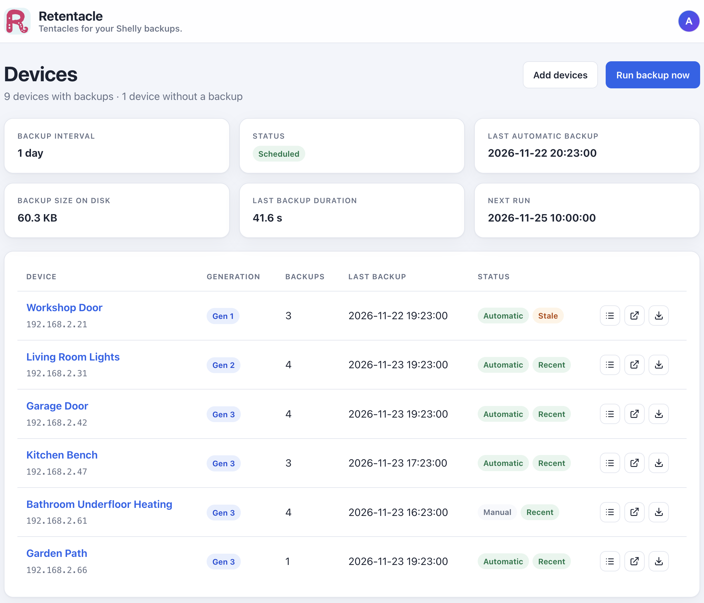
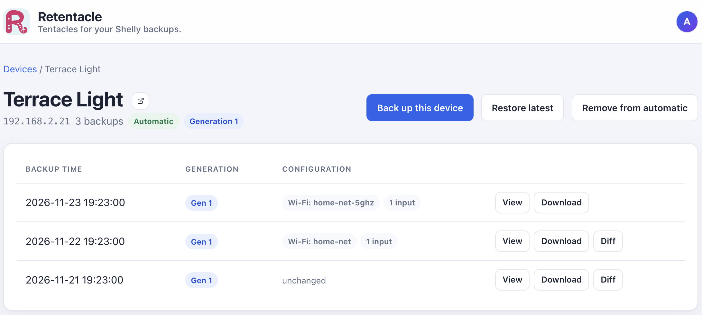

# Retentacle

[](https://github.com/exxamalte/retentacle/actions/workflows/tests.yml)
[](https://codecov.io/gh/exxamalte/retentacle)

*“Tentacles for your Shelly backups.”*

Retentacle is a long-running backup server and command line tool for Shelly
devices. It fetches the configuration of Shelly devices, stores snapshots in a
local TinyDB database, and provides a web UI for browsing backups per device.
This is useful when a device loses its configuration — after a failed firmware
update, a reset to defaults, or when a replacement unit takes over.

Retentacle never writes to a device on its own: every backup page hands you the
exact payload and a ready-made command, so restoring stays a deliberate act.



## Features

* Support for generation 1, 2 and 3 devices.
* Scheduled backups with a selectable next run time and interval, and a slot
  that stays sticky across restarts, catch-up runs and manual backups.
* Configurable retention for monthly, weekly, daily, and hourly backups.
* Web UI for browsing devices, backup history, and individual backup snapshots.
* Restore-oriented backup views: three zones per backup (restorable payload,
  configuration table, live state), a dedicated `restore.json` download, and a
  pre-filled `curl` command for `Shelly.SetConfig` or `POST /settings`.
* Configuration diff between any two backups of a device, with changed, added
  and removed settings listed separately and credentials masked.
* User accounts with admin and read-only roles, created on first startup.
* Optional OpenID Connect single sign-on with automatic user provisioning.
* One-shot backup mode for scripts and cron jobs.
* Auto-discovery of Shelly devices via mDNS, on the command line and in the web
  UI.
* Container image with sane volume and permission defaults.
* In-app update notification for published releases (admins only).
* Fetches device configuration:
  * Gen 1: settings, actions and status.
  * Gen 2 and Gen 3: configuration, device info and status.

Not supported: devices with device-side authentication enabled, and pushing
configurations back to a device automatically — restoring is always something
you run yourself.



## Quick start

```commandline
pip install .
retentacle
```

Open `http://127.0.0.1:8080`, create the initial admin account, and add your
device IP addresses on the **Settings** page. Or run the container:

```commandline
docker run -d --name retentacle -p 8080:8080 -v retentacle-data:/data \
  ghcr.io/exxamalte/retentacle:main
```

## Documentation

| Page | Covers |
| --- | --- |
| [Installation](docs/installation.md) | Python and container installation, first start, development setup. |
| [Configuration](docs/configuration.md) | Command line options, configuration file, environment variables, one-shot backups, mDNS auto-discovery. |
| [Backups and scheduling](docs/scheduling.md) | Intervals, the sticky schedule grid, catching up after downtime, manual versus automatic runs, retention effects on recency. |
| [Web interface](docs/web-ui.md) | Every page and endpoint, dashboard cards, history view, toasts, update badge, accessibility. |
| [Restoring from a backup](docs/restoring.md) | The three restore zones, `restore.json`, the `curl` command, diffs, restoring to a replacement device. |
| [Accounts, roles and single sign-on](docs/authentication.md) | The setup wizard, roles and permissions, sessions, avatar menu, OIDC setup and recovery. |
| [Docker deployment](docs/docker.md) | Image tags, data folder and `PUID`/`PGID`, reverse proxies, discovery networking, permission troubleshooting. |
| [Data, retention and privacy](docs/data.md) | The three databases, retention periods, credentials in backups, moving an installation. |
| [Releases and update checks](docs/releases.md) | Version and tag conventions, pre-release classification, how the update badge decides. |

Changelog: [CHANGELOG.md](CHANGELOG.md). Example configuration:
[`configuration.example.yaml`](configuration.example.yaml).

## License

Apache License 2.0 — see [LICENSE](LICENSE).
