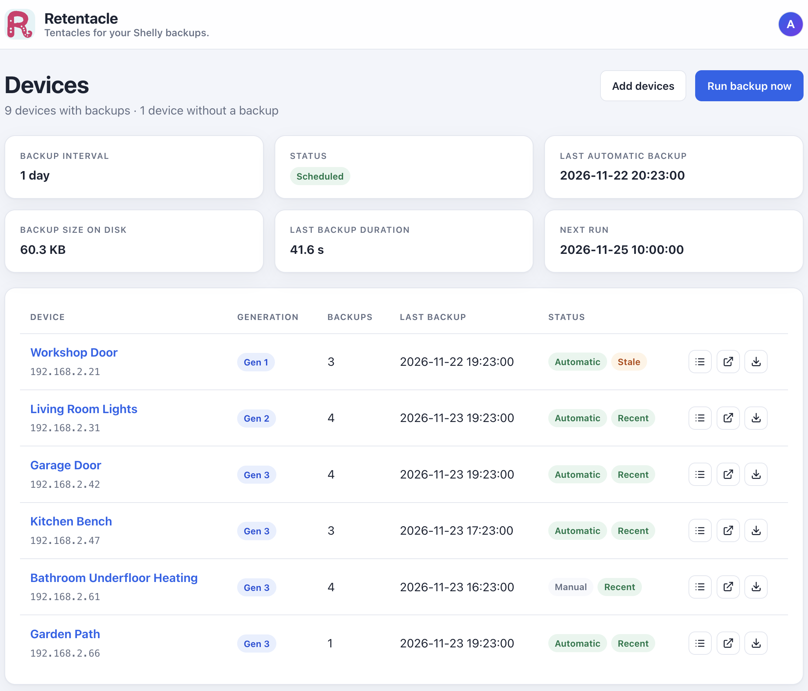
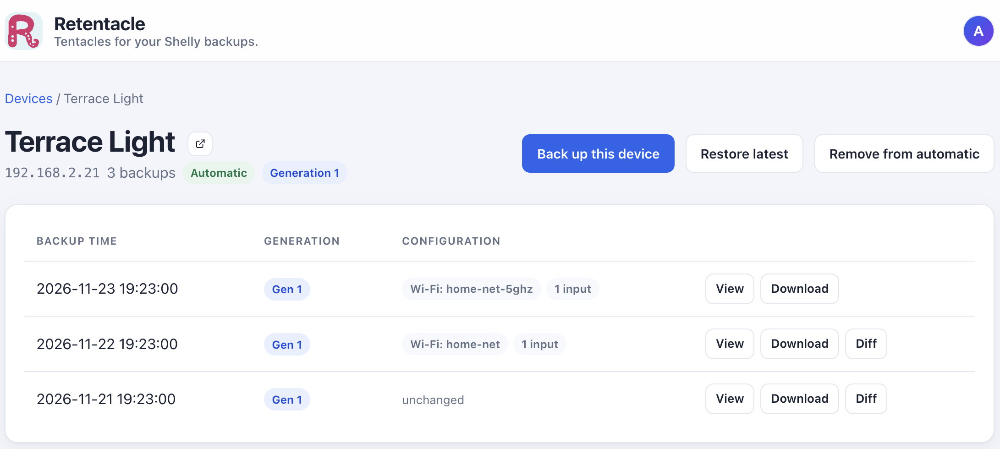

# Web interface

> Part of the [documentation](../README.md#documentation)

| Path | Purpose |
| --- | --- |
| `/` | Devices overview with scheduler status, backup counts, last automatic backup, total backup size on disk, the duration of the last automatic backup, next run time, and per-device indicators for automatic backups and recent backups. |
| `/devices/<ip-address>` | All backups for one device, newest first, with per-backup configuration chips, an "unchanged" marker for identical configs, plus links to the device web UI and to restoring the latest backup. Admins can also add or remove that single device from the automatic-backup list right from this page. |
| `/devices/<ip-address>/compare?a=<id>&b=<id>` | Leaf-level diff of the restorable configurations of two backups (changed / added / removed, credentials masked, live state excluded); defaults to the newest pair. |
| `/backups/<id>` | Metadata, a manual restore section, a configuration summary, the device state at backup time, and raw JSON for a single backup. |
| `/backups/<id>/download` | Download a backup as JSON. |
| `/backups/<id>/restore.json` | Download only the restorable configuration, ready for `Shelly.SetConfig` (Gen 2/3) or `POST /settings` (Gen 1). |
| `/settings` | Configure the backup schedule, device IP addresses, and single sign-on, and manage user accounts, roles, and passwords (admin only). |
| `/settings` → Discover devices | On-demand mDNS scan with a countdown; see [Configuration](configuration.md#auto-discovery). |
| `/setup` | First-run wizard to create the initial admin account. |
| `/login`, `/logout` | Sign in and out. |
| `/oidc/login`, `/oidc/callback` | OpenID Connect single sign-on flow. |
| `/api/status` | Scheduler status and live backup progress as JSON. |
| `/health` | Server and scheduler status as JSON — the only page that does not require a login, and what the container health check polls. |
| `/users` | Legacy alias that redirects to `/settings`. |

## Dashboard

The dashboard header offers **Run backup now** (admins only) and **Add devices**,
which jumps straight to the device section of the Settings page. On a fresh
install both actions also appear in the "No backups yet" panel. Six cards
summarise the interval, whether backups are scheduled or running, the last
automatic backup, the total size of all backups on disk, the duration of the
last automatic backup, and the next run; what each of them means — and which
runs move them — is covered in [Backups and scheduling](scheduling.md).

Each device row in the overview offers its actions — view backups, open the
device web UI, and back up this device — as compact icon buttons with tooltips
and screen-reader labels, so the table stays readable without horizontal
scrolling. The device detail page keeps these as labelled buttons, including
**Back up this device**, to back up just that device without waiting for the
next scheduled run.

## Device pages and history

The device detail page shows the name, address and status badges in the title
line, the web-UI link right next to the name, and the actions group beside it.
Each history row carries configuration chips (Wi-Fi SSID, MQTT state, component
counts, firmware), an **unchanged** marker where the configuration matches the
newer backup, a **Diff** link against the next newer backup, and the usual
download links. Rows without a newer backup get no Diff link at all, so the
action always means something. Details in
[Restoring from a backup](restoring.md).

Shelly devices usually serve their own configuration page over HTTP, so each
device's web UI can be opened in a new tab from the overview icon or the detail
page link. It opens `http://<ip-address>`; Retentacle does not proxy or reach
the device itself.

## Feedback while a backup runs

While a backup is running, the page shows a live progress bar and updates the
status automatically. Once the run finishes, the page reloads so newly created
backups appear without a manual refresh.

Transient messages — a started or finished backup, saved settings, a failed form
— appear as auto-dismissing toast notifications in the lower-right corner,
overlaying the page instead of shifting tables and buttons down. They stack,
close on click, and announce themselves politely to screen readers. Messages
that describe a persistent state, such as the failure of the last scheduled run,
stay inline instead: they are status, not events.

## Update notifications

When a newer version is published, admins see a warning-toned badge in the
header (e.g. **v2026.6.0 available**) linking to the release page; read-only
accounts never see it. The badge appears once a check has completed — checks run
in the background when a signed-in user views the dashboard or the Settings
page, and results are cached for 6 hours, so the app works fine without internet
access (it just never shows the badge). How the check classifies versions is
covered in [Releases and update checks](releases.md).

## Accessibility

The layout follows the system appearance (`prefers-color-scheme`) without a
separate theme switch, honours `prefers-reduced-motion` for animations, gives
every icon button a tooltip and an `aria-label`, marks live regions on status
text and toasts, and keeps focus visible throughout. Settings panels are wide
single-purpose cards so the forms stay readable on narrow screens.
